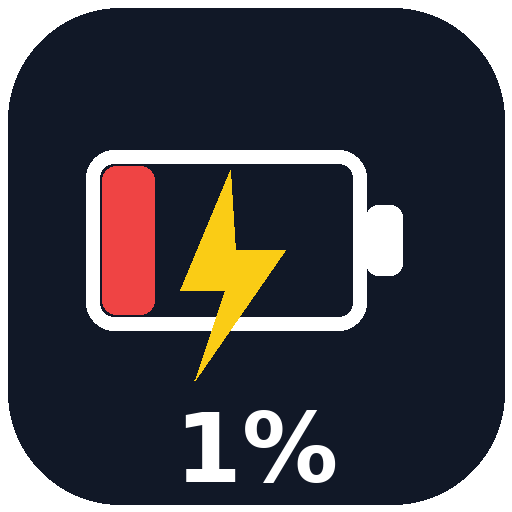

# Battery Alert

**Battery Alert** warns you before your phone dies. When your battery hits **1%** and you are not charging, it shows a full-screen pop-up, plays a sound, and vibrates — once per low-battery episode.

## Features
- Triggers at exactly 1% battery, only when not charging
- Full-screen red pop-up, even on the lock screen
- Normal notification sound + vibration (no alarm)
- Warns only once per 1% episode (no repeat spam)
- Stops automatically when you plug in
- Foreground service, auto-restart if swiped away, and a per-device background permission button
- Auto-starts after reboot
- Uninterrupted mode: opens your brand's own autostart / battery page (Samsung, Xiaomi, Huawei, Oppo, Vivo, OnePlus, Asus) and requests ignore-battery-optimizations
- Modern dark UI, English interface

## How it works
1. Install the APK from Releases.
2. Open **Battery Alert**.
3. Tap **Start Protection**.
4. Allow notifications and "Display over other apps" when asked.
5. For best reliability, exclude the app from battery optimization.

When the battery reaches 1%, you will see:

> **BATTERY 1%!**
> Your phone is about to shut down. Plug in the charger now!

Tap **OK** to dismiss that pop-up. It warns only once per 1% episode.

## Permissions
- `FOREGROUND_SERVICE` / `FOREGROUND_SERVICE_SPECIAL_USE` — keep the monitor running
- `POST_NOTIFICATIONS` — show the alarm notification
- `VIBRATE` — vibration alert
- `SYSTEM_ALERT_WINDOW` — show the pop-up over other apps and the lock screen
- `RECEIVE_BOOT_COMPLETED` — restart protection after reboot
- `WAKE_LOCK` — wake the screen for the alert

No data is collected, no account is needed, nothing leaves your phone.

## Technical details
- Package: `com.bmo.sarjuyari`
- Version: 1.3 (versionCode 4)
- Min SDK: 26 (Android 8.0+)
- Target SDK: 34 (Android 14)
- Built with aapt2 + d8, signed, zipaligned
- Source layout: `MainActivity` (UI), `BatteryService` (foreground monitor, `ACTION_BATTERY_CHANGED`), `AlertActivity` (full-screen warning), `BootReceiver` (auto-start)

## Download
Get the APK from the **Releases** page: `battery-alert.apk`

## Screenshots / behavior
- Main screen: dark modern UI with live battery percentage
- Alert screen: full-screen red warning with big "BATTERY 1%!" text

## Source code
Full source code is in this repository as `battery-alert-source.zip` (AndroidManifest, Java sources, layouts, drawables, icon, README, LICENSE). Unzip it to build the app yourself with aapt2 + d8, or open the files in `proj/`.

## Tags
Search terms people use when they want this app — in Turkish and English, problem-focused:

Turkish:
- sarjim %1 oldugunda uyari versin
- sarj %1 oldugunda uyari
- telefon kapanmadan once uyari
- sarj bitmeden uyari veren uygulama
- sarj azalinca alarm
- sarj %1 alarm uygulamasi
- telefon sarji bitince haber ver
- sarjim bitiyor uyarisi
- sarj dusukken pop-up uyari
- sarj bitmeden once sesli uyari
- android sarj uyarisi uygulamasi
- sarj %5 %10 uyari (not: bu uygulama %1'de uyarir)
- telefon kapanmasin diye uyari
- sarj bitti uyarisi android
- dusuk sarj bildirimi uygulamasi
- sarj takip uygulamasi android
- pil %1 uyari uygulamasi
- sarj bitince telefon kapaniyor cozum
- sarj aniden bitiyor uyari yok
- android pil uyarisi ayarlama

English:
- battery 1% warning app
- warn me when battery reaches 1%
- low battery warning android
- phone shutdown warning app
- battery low pop-up alert
- alert before phone dies
- android battery alert app
- 1 percent battery notification
- battery dies without warning fix
- low battery alarm android app
- full screen battery warning
- battery warning when not charging
- android app that warns at 1% battery
- prevent phone shutdown warning
- battery level alert android
- low battery sound notification app
- phone battery low warning popup
- android background battery monitor app
- battery alert no repeat spam
- how to get warned at 1% battery android
